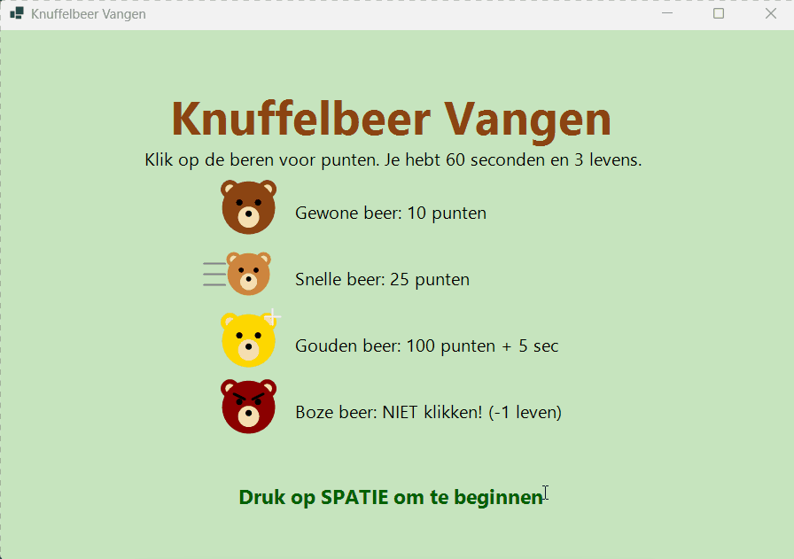
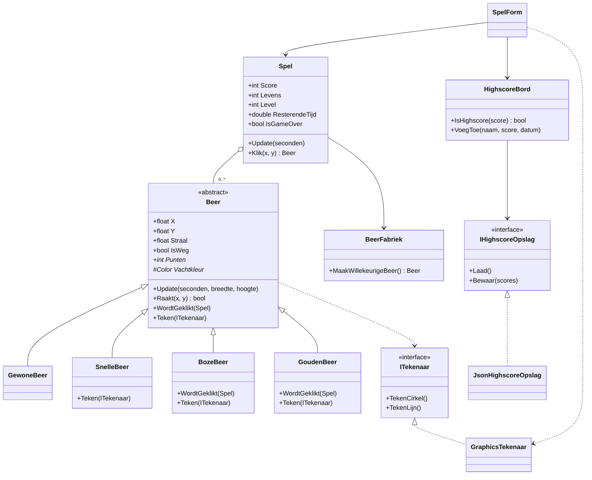

# Knuffelbeer Vangen 🧸

Een klein klikspel in C# en Windows Forms. Beren lopen over het scherm: klik ze weg voor punten, maar blijf van de boze beren af. Gemaakt om objectgeoriënteerd programmeren te oefenen: overerving, polymorfisme, scheiding van logica en UI, en unit tests.



## Spelregels

| Beer | Punten | Bijzonder |
|---|---|---|
| Gewone beer | 10 | De standaard beer |
| Snelle beer | 25 | Kleiner en ruim twee keer zo snel |
| Gouden beer | 100 | Zeldzaam (5%), snel weer weg, geeft **5 seconden extra** |
| Boze beer | 0 | **Niet klikken!** Kost een leven |

- Je hebt **60 seconden** en **3 levens**.
- Elke **200 punten** ga je een level omhoog: er komen vaker beren en ze lopen sneller.
- De top 10 wordt bewaard als JSON-bestand.

## Starten

Vereist: Visual Studio 2022 (of nieuwer) met de workload ".NET desktop development", en .NET 8.

1. Open `KnuffelBeerSpel.sln`.
2. Zet `KnuffelBeerSpel` als opstartproject en druk op **F5**.

Tests draaien: **Test → Run All Tests** in Visual Studio, of in een terminal:

```bash
dotnet test
```

## Projectstructuur

```
KnuffelBeerSpel.sln
├── KnuffelBeerSpel.Core/      Spellogica, geen Windows Forms
│   ├── Beren/                 Beer (abstract) + 4 soorten + BeerFabriek
│   ├── Highscores/            HighscoreBord + opslag in JSON
│   ├── ITekenaar.cs           Interface waarmee beren zichzelf tekenen
│   └── Spel.cs                Score, levens, level, tijd
├── KnuffelBeerSpel/           Windows Forms: tekent en geeft klikken door
└── KnuffelBeerSpel.Tests/     xUnit-tests voor de Core
```

## Klassendiagram



## Ontwerpkeuzes

**Waarom een abstracte klasse `Beer`?**
Alle beren bewegen, stuiteren en worden op dezelfde manier geraakt. Die code staat één keer in `Beer`. Een "beer zonder soort" bestaat niet in het spel, dus `Beer` is `abstract`: je kunt er geen `new Beer()` van maken. `Punten` en `Vachtkleur` zijn `abstract`, omdat elke soort die zelf móét bepalen.

**Waarom `virtual` voor `WordtGeklikt()` en `Teken()`?**
De meeste beren geven gewoon punten, dus daar is een standaard voor. Alleen de soorten die iets anders doen overschrijven de methode: `BozeBeer` kost een leven, `GoudenBeer` roept eerst `base.WordtGeklikt()` aan en geeft daarna extra tijd. Dit is polymorfisme: `Spel` roept `beer.WordtGeklikt(this)` aan zonder te weten welke soort het is.

**Wat moet er veranderen voor een nieuwe soort beer?**
Alleen een nieuwe subklasse en één regel in `BeerFabriek`. `Spel` en `SpelForm` blijven hetzelfde.

**Waarom staat de logica niet in het formulier?**
`KnuffelBeerSpel.Core` gebruikt geen Windows Forms. Het formulier geeft alleen de tijd en de klikken door aan `Spel` en tekent het resultaat. Daardoor kan alle spellogica getest worden zonder venster, en zou je er later een andere UI op kunnen zetten.

**Hoe tekent een beer zichzelf zonder Windows Forms te kennen?**
Via de interface `ITekenaar`. De beer zegt "teken hier een bruine cirkel"; `GraphicsTekenaar` in het WinForms-project vertaalt dat naar `Graphics.FillEllipse`. In de tests gebruik ik een nep-tekenaar die alleen telt.

**Hoe test je iets met willekeur en tijd?**
- `Spel` krijgt een `Random` via de constructor. Tests gebruiken `new Random(42)`, zodat elke run dezelfde beren geeft.
- `Spel` heeft geen eigen timer, maar een methode `Update(seconden)`. Het formulier roept die aan vanuit een timer; een test roept gewoon `spel.Update(60)` aan.

**Waarom een interface voor de highscore-opslag?**
`HighscoreBord` sorteert en bewaart de top 10, maar weet niet wáár. Nu is dat een JSON-bestand; met een `SqliteHighscoreOpslag` zou het een database worden zonder dat `HighscoreBord` verandert. In de tests gebruik ik een opslag in het geheugen.

## Tests

37 tests met xUnit, onder andere:

- Klik op een gewone beer → +10 punten
- Klik op een boze beer → één leven minder, geen punten
- Klik op een gouden beer → punten én extra tijd
- Twee beren over elkaar → alleen de bovenste telt
- Na 60 seconden of 0 levens → game over, klikken telt niet meer
- Elke 200 punten een level hoger, beren sneller en vaker
- Highscores: gesorteerd, maximaal 10, lege naam wordt "Anoniem", kapot JSON-bestand laat het spel niet crashen

## Mogelijke uitbreidingen

- Highscores in SQLite in plaats van JSON
- Geluidseffecten
- Een pauzeknop
